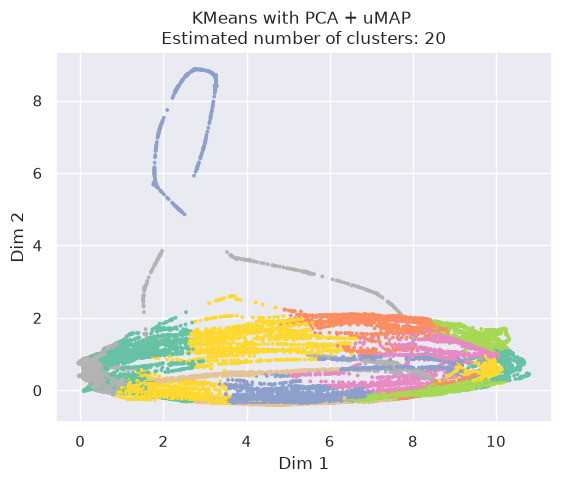
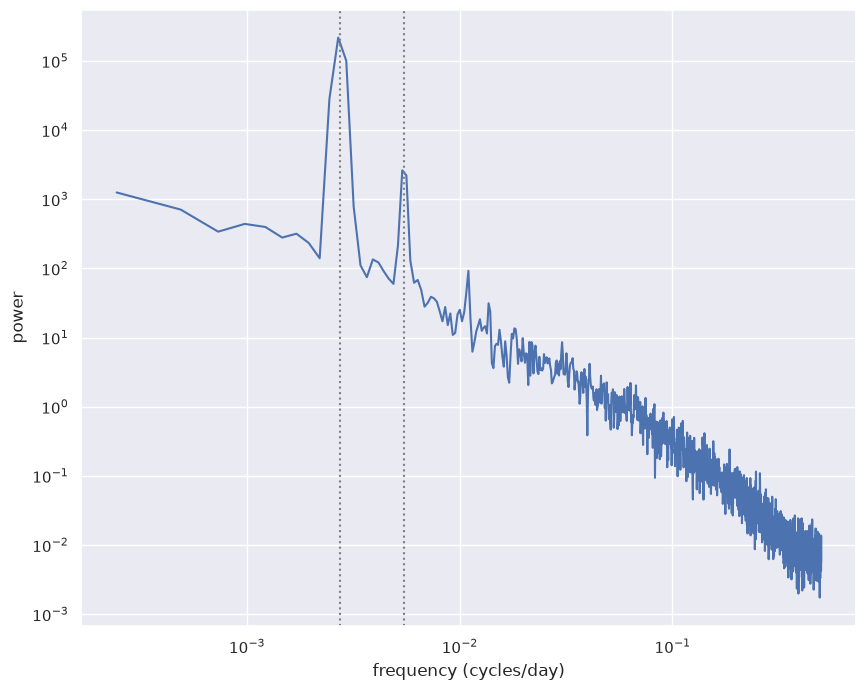
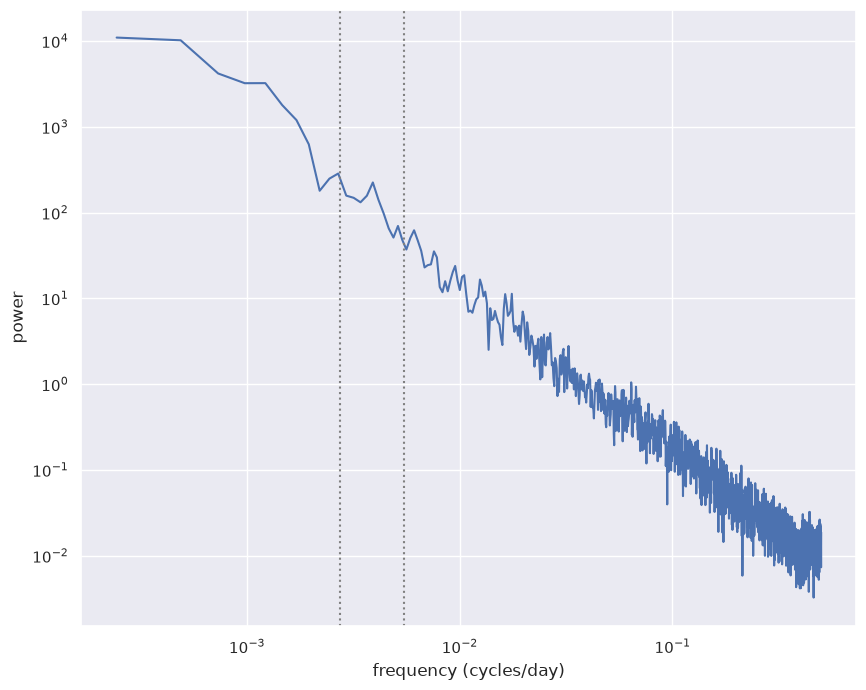
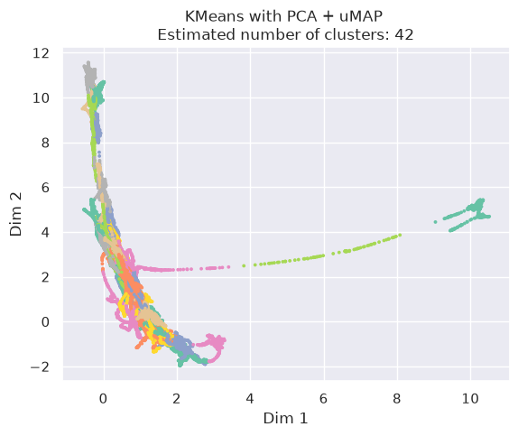

# Weather Latent Space Clustering

This involves attempting to Cluster a latent space from a VAE with weather data. The latent space is of dimension (59900,1024,8x15) 59900 timesteps 1024channels with 8x15 spatial points. The data was too heavy for my personal computer to run so I took 1 timestep from each day instead of 4 and combined the spatial components with 1024 channels and I was left with a matrix of size (14975,122880)

Due to the large size doing PCA on it was not possible as the Covariance matrix was too big, so I performed IncrementalPCA on it with a certain batchsize and calculated the pca scores and used that to do KMeans on the data.

Since the aim of this project is to make a dictionary of the states fromm the clusters I need as many clusters as I can to account for each weather state. So I ran KMeans for different values of k and took the k that gave the highest Silhouette Score. I tried looking at both whittened and unscaled data. Scaling the data resulted in lower number of clusters giving a better score so I decided to go with Unscaled data.

Its Visible from this the ring shape is showing seasonality over the span of 40 years and the points thats going upwards must be extreme weather conditions. So i decided to look at the power spectrum to see which components had the highest frequency and to remove them.

The components with the most power were removed and using the new values plots were made

After removal the scores went up to 0.3906 from 0.339 which is an increase of 0.0509.

            
